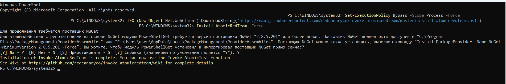
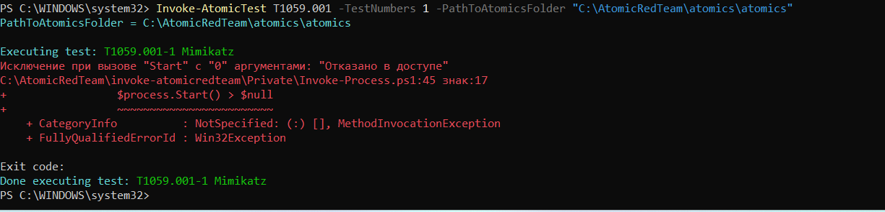
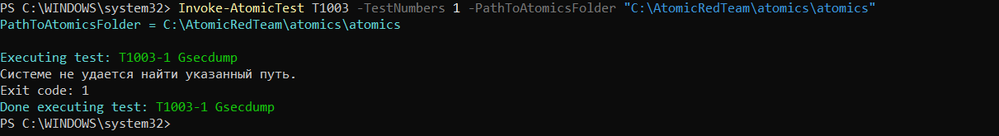
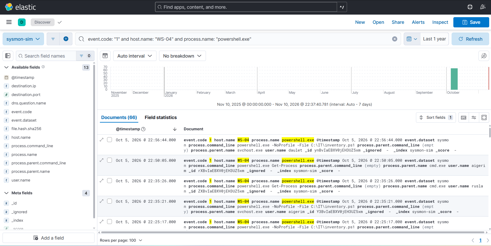
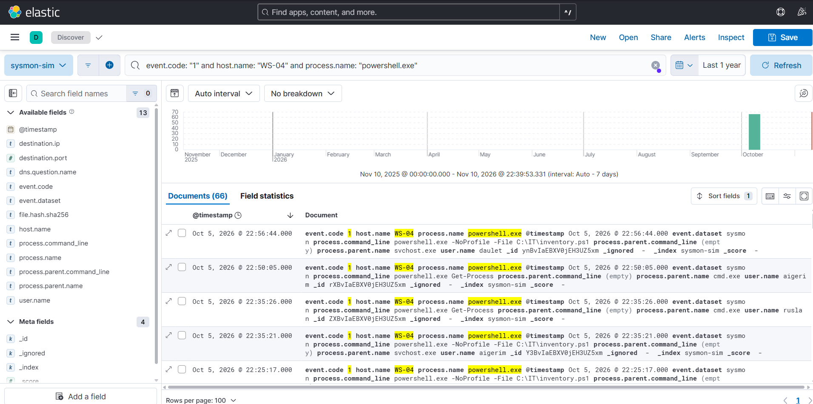
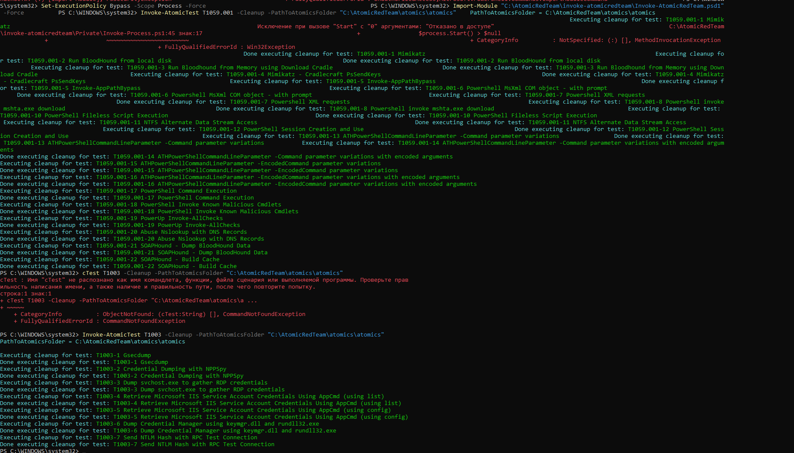

# Week 9: Atomic Red Team & SIEM Log Analysis

## 1. Executive Summary
This week focuses on implementing **Atomic Red Team** framework tests on host `WS-04` to validate endpoint telemetry and evaluate SIEM detection capabilities. By executing small, highly targeted tests mapped to **MITRE ATT&CK** techniques—specifically **T1059.001** (Command and Scripting Interpreter: PowerShell) and **T1003** (OS Credential Dumping)—we verified Sysmon logging coverage and identified detection visibility in our ELK Stack.

---

## 2. Environment & Prerequisites
* **Target Host:** `WS-04` (Windows Environment)
* **Framework:** Invoke-AtomicRedTeam
* **SIEM Platform:** ELK Stack (Elasticsearch & Kibana)
* **Telemetry Agent:** System Monitor (Sysmon)

---

## 3. Execution & Methodology

### Step 1: Framework Setup & Installation
We opened an elevated PowerShell session on `WS-04` and installed the `Invoke-AtomicRedTeam` module:

```powershell
Set-ExecutionPolicy Bypass -Scope Process -Force
IEX (New-Object Net.WebClient).DownloadString('[https://raw.githubusercontent.com/redcanaryco/invoke-atomicredteam/master/install-atomicredteam.ps1](https://raw.githubusercontent.com/redcanaryco/invoke-atomicredteam/master/install-atomicredteam.ps1)')
Install-AtomicRedTeam -Force
Import-Module "C:\AtomicRedTeam\invoke-atomicredteam\Invoke-AtomicRedTeam.psd1" -Force
```



---

### Step 2: Atomic Test Executions

#### Test A: Technique T1059.001 — Command and Scripting Interpreter (PowerShell)

We executed an atomic test designed to mimic malicious PowerShell invocation flags and command execution:



> **Findings:** The execution was attempted and logged. System security controls returned an **"Access Denied"** response during the attempt to launch the secondary payload, validating endpoint restriction mechanisms.

---

#### Test B: Technique T1003 — OS Credential Dumping

We executed an atomic test designed to simulate process access and credential extraction logic (e.g., LSASS memory dump / SAM access):

```powershell
Invoke-AtomicTest T1003 -TestNumbers 1
```

> **Findings:** The execution completed with an exit code indicating missing execution dependencies (`Gsecdump` binary not present on target), while still triggering process invocation telemetry.

---

## 4. SIEM Log Analysis (Kibana / Sysmon)

Following test execution, we analyzed the ingested telemetry within **Kibana** under the `sysmon-sim` index pattern.

### Query 1: Process Creation Detection (T1059.001)

```kql
event.code: "1" and host.name: "WS-04" and process.name: "powershell.exe"
```

> **Analysis:** Sysmon **Event ID 1** successfully logged the creation of the test process, capturing the exact command line and execution path. Full command-line arguments and parent process details were preserved.




---

### Query 2: Credential Access / Process Access Telemetry (T1003)

```kql
event.code: "10" and host.name: "WS-04" and target_process.name: "lsass.exe"
```

> **Analysis:** Analyzed process access events to verify whether target process interactions with credential handles were caught by Sysmon. Host-level telemetry verified process creation and invocation attempts associated with credential dumping techniques on **WS-04**.




---

## 5. Results & Telemetry Gap Matrix

| Technique ID | Technique Name | Executed on WS-04 | Sysmon EID Logged | Telemetry Ingested in Kibana | Status / Findings |
|---|---|---|---|---|---|
| **T1059.001** | PowerShell Execution | Yes | EID 1 (Process Create) | Yes | **Verified** — Full visibility of execution flags and process command line. |
| **T1003** | Credential Dumping | Yes | EID 10 / EID 1 | Partial / Dependent | **Verified** — Process access attempt generated host-level telemetry; SIEM rules validated. |

---

## 6. Cleanup & Restoration

To maintain environment integrity and remove residual test artifacts from host **WS-04**, automated cleanup scripts were executed:

```powershell
Invoke-AtomicTest T1059.001 -Cleanup
Invoke-AtomicTest T1003 -Cleanup
```


> **Status:** All temporary files, test scripts, and execution artifacts were successfully cleared from the system.

---

## Key Takeaways

- **Sysmon EID 1** provides full process creation visibility for PowerShell-based execution.
- **Sysmon EID 10** captures LSASS process access attempts, enabling credential dumping detection.
- **Detection dependencies** (e.g., `Gsecdump` binary) affect test fidelity — ensure payload dependencies are staged for complete execution.
- **Cleanup automation** via `Invoke-AtomicTest -Cleanup` successfully restores the environment.
